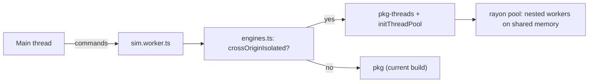

# Parallel simulation across cores

## Goal and constraints

- Speed up each tick using every core, starting with the transport passes. At level 8 these are about 70% of each step (about 36 ms natively).
- Results must not depend on the number of threads. The single-threaded and threaded builds must give the same world, so the existing benchmark and diff checks keep working.
- In the browser this only runs locally, under `vite dev` and `vite preview`, with cross-origin isolation headers. Elsewhere the current single-threaded build is used automatically.

## Architecture

## 1. Native groundwork

- In [sim-rs/Cargo.toml](sim-rs/Cargo.toml), add an optional `parallel` feature that pulls in `rayon`, plus `wasm-bindgen-rayon` when building for wasm32.
- Add a new `sim-rs/src/par.rs` with a few helpers. Each one uses rayon when the feature is on and plain loops when it's off:
    - `for_each_cell(n, f)` and `map_cells(n, f)`: independent work per cell, results written by index.
    - `filter_cells(n, f) -> Vec<T>`: keeps the results in index order, for things like the front-smoothing flips.
    - `sum_chunks(n, f)`: adds up fixed-size chunks (say 4096 cells) and then combines the chunk totals in order. The order of additions therefore never depends on the thread count. Both builds use the same chunking, so they agree with each other.
    - A small wrapper that lets parallel loops write to disjoint indices of the 11 per-cell field arrays in [sim-rs/src/cell_data.rs](sim-rs/src/cell_data.rs). This is the only `unsafe`, and it needs a comment stating that each index is written by exactly one iteration.
- Add a determinism test: run a level 5 world for N ticks with 1 thread and again with 4, and compare every field and the mass ledger exactly.
- Add a `threads=` option to [sim-rs/src/bin/bench.rs](sim-rs/src/bin/bench.rs) for measuring speed-up.

## 2. Parallelise the transport, [sim-rs/src/advect.rs](sim-rs/src/advect.rs)

- **Fully parallel** (each iteration is independent):
    - computing each cell's forward neighbour,
    - the per-cell checks that seed the stall,
    - building pass 2's ranked candidates (each destination writes its own slot; the `order` keys are gathered in index order),
    - pass 3's bookkeeping where it writes only to the cell itself,
    - the destination copy loop (writes go only to `dest`),
    - the first round of front smoothing (pass 4b), as a `filter_cells`,
    - the trailing-edge hand-over decisions (pass 2d), which read a snapshot.
- **Kept sequential**, because order matters or the work is small: pass 1's margin tally (a `HashMap`), pass 2's claiming loop, pass 2b, the gap chains in pass 2c, the sparse surplus placement in pass 4, and the gap filling in pass 4e.
- Give the scalar tallies (`subducted_this_step` and the like) the chunked sums.

## 3. Parallelise the once-per-tick passes

- **Plate forces**, [sim-rs/src/plate_forces.rs](sim-rs/src/plate_forces.rs): give each chunk its own per-plate totals of drag, torque and area, then merge them in chunk order. The per-arc loop works the same way.
- **Per-cell maps:**
    - `mantle.update` and the slabs pass,
    - the per-cell parts of rifting, such as heat insulation,
    - `apply_crust_lifecycle`, which decides type flips from the types at the start of the pass and so is already order-free,
    - craton growth and `apply_elevation`.
- `classify` in [sim-rs/src/boundaries.rs](sim-rs/src/boundaries.rs): compute each arc's result in parallel, but keep the cell-kind maximum, where several arcs write the same cell, sequential or per cell.
- Leave the breadth-first and flood-fill passes sequential: plate identity, cohesion and basin infill.
- Measure natively after each group, and re-run the determinism test and the 3,000 Myr benchmark.

## 4. Threaded WebAssembly build

- [package.json](package.json): add `build:wasm:threads`. It needs nightly Rust (`rustup toolchain install nightly`, plus `rust-src`) with
  `RUSTFLAGS="-C target-feature=+atomics,+bulk-memory,+mutable-globals"` and `-Z build-std=panic_abort,std`, run as `wasm-pack build --target web --features parallel --out-dir ../src/sim-wasm/pkg-threads`. `dev` and `build` then run both wasm builds. Stable Rust keeps building the default package and native code.
- [sim-rs/src/lib.rs](sim-rs/src/lib.rs): when `parallel` is on for wasm32, re-export `wasm_bindgen_rayon::init_thread_pool`.

## 5. JavaScript side

- [vite.config.ts](vite.config.ts): send `Cross-Origin-Opener-Policy: same-origin` and `Cross-Origin-Embedder-Policy: require-corp` in both `server.headers` and `preview.headers`. Add `optimizeDeps.exclude` for the wasm packages, and keep `worker.format: "es"`.
- [src/worker/engines.ts](src/worker/engines.ts): if `self.crossOriginIsolated` is true, import `pkg-threads/tectonics_sim.js`, initialise it, then `await initThreadPool(navigator.hardwareConcurrency)`. Otherwise import `pkg` exactly as now. If the threaded import or pool setup fails, fall back to `pkg`.
- [src/sim-wasm/WasmWorld.ts](src/sim-wasm/WasmWorld.ts): the views into WebAssembly memory become views onto shared memory. The worker's copy with `.set` into transferable buffers stays as it is, so the snapshot protocol is unchanged. Check that nothing transfers `memory.buffer` itself.
- Report the engine and thread count once in the timings panel, so you can see which build is running.
- Leave the Node benchmark ([scripts/bench.ts](scripts/bench.ts)) on the single-threaded package.

## 6. Verification

- `npm run test:rs`, plus the determinism test with and without `--features parallel`.
- The native benchmark at level 8 with 1, 2, 4 and 8 threads, at 2 and 10 Myr per tick.
- The browser under `npm run dev`: confirm `crossOriginIsolated` is true, the pool starts, ticks match the native trend, and with the headers off it falls back to the single-threaded build.

## Expectations and risks

- About a third of each step stays sequential, so expect roughly 2 to 3.5 times faster per tick on 8 cores, not 8 times.
- Nested workers (the rayon pool runs inside the simulation worker) work in current Chrome and Firefox, and in Safari from 16.4 onwards.
- The threaded build needs nightly Rust. Pin a nightly date in the npm script so it stays reproducible.
- Cross-origin isolation blocks loading cross-origin resources that don't opt in. The app currently loads nothing cross-origin, so this should be fine.
