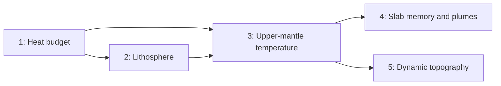

# Planetary heat and mantle layers

## Phases

1. [Global heat budget](mantle_phase1_heat_budget.plan.md): `PlanetHeat` in a new `heat.rs` replaces the `mantle_excess` exponential outright, with radiogenic decay and core heat going in and surface heat flow coming out. Mantle temperature then controls viscosity, ridge height and new ocean crust thickness.
2. [Lithosphere and column buoyancy](mantle_phase2_lithosphere_buoyancy.plan.md): a per-cell `lithosphere` field. `density` becomes crust-only, and subduction polarity and slab pull come from whole-column buoyancy.
3. [Upper-mantle temperature](mantle_phase3_upper_mantle_temperature.plan.md): a temperature anomaly on each of the 642 mantle sites drives upwelling and links per-cell `mantle_heat` to the global budget.
4. [Slab memory and plume sites](mantle_phase4_slab_memory_plumes.plan.md): a lower-mantle slab pile. Plumes rise at pile edges, at a rate set by core heat flow.
5. [Dynamic topography](mantle_phase5_dynamic_topography.plan.md): mantle-driven uplift and subsidence added to the elevation baseline.

## Order and dependencies

Phases 4 and 5 are independent of each other. Phase 2 could in principle come after 3, but landing it straight after the heat budget keeps the two behaviour-changing phases (heat curve, then subduction rules) next to each other, so calibration happens early and only once per change.

## Shared rules for every phase

- Each phase lands with its own Rust exposure, TypeScript tuning and controls, view mode where relevant, and bench columns. There's no separate UI phase at the end.
- Each phase is benchmarked over 3000 Myr against the previous phase's baseline before the next one starts.
- Results must match at 1 and 4 threads, following the [parallelisation plan](parallel_sim_across_cores_f1540e63.plan.md). Use `par::sum` and the other `par` helpers for any new reductions.
- Use UK spelling and arrow functions in TypeScript.
