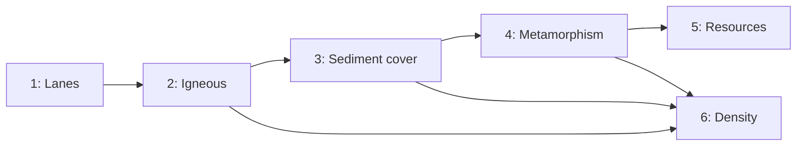

# Rock cycle and resources

## Why

Density is one of two constants (`continental_density`, `oceanic_density`), so the density view only repeats crust type. The goal is for every cell to know what rock it is made of and what that rock has been through, and to read resource potential off that history. Resources are not placed by hand.

## Phases

1. [Composition lanes](rock_cycle_phase1_composition_lanes.plan.md): a refactor with no behaviour change. `plume_share` and `sediment_share` become two lanes of one lane-major block, mixed by mass in one loop instead of at about 20 hand-copied sites.
2. [Igneous composition](rock_cycle_phase2_igneous.plan.md): mafic and felsic lanes, written where crust is made (ridges, plumes, arcs), plus differentiation of thick crust and an arc-magmatism clock.
3. [Sediment cover](rock_cycle_phase3_sediment_cover.plan.md): a cover layer on top of the basement. Erosion strips cover first and carries the source composition downhill. Deep cover lithifies into basement metasediment. This phase also adds the climate seams.
4. [Metamorphism and exhumation](rock_cycle_phase4_metamorphism.plan.md): peak pressure and temperature of the rock now at the surface, from how deep erosion has cut and the geotherm.
5. [Resource potential](rock_cycle_phase5_resources.plan.md): rules over the fields above give per-cell potential for climate-independent deposit types, with a view and bench reporting.
6. [Density from composition](rock_cycle_phase6_density.plan.md): crust density is mixed from lithology densities. This is the only phase meant to change the dynamics.

## Order and dependencies

Phases 5 and 6 are independent. Resources come first so that every output-only phase lands before the one that changes the dynamics. Calibration then happens once, against a world whose composition is already settled.

## Composition already feeds the dynamics

`hot_drip` in [sim-rs/src/primordial.rs](sim-rs/src/primordial.rs) (near line 375) treats `1 - plume_share - sediment_share` as the mafic share that can founder. Until phase 6, that expression must keep reading the same quantities:
- Phase 2 leaves drip on the plume and sediment shares, not on the new mafic lane.
- Phase 3 changes what `sediment_share` means (erosion now strips cover). So phase 3 verifies with `hot_drip = 0`, where the dynamics fingerprint must match bit for bit, and reports the drift with drip on.
- Phase 6 switches drip to the mafic lane on purpose.

## Climate interface

There is no climate model yet. Everything that will depend on climate goes through three seams. Each seam is one function that returns a neutral answer when no climate is present:

1. `weathering_rate(climate, i)`: a multiplier on erosion in [sim-rs/src/erosion.rs](sim-rs/src/erosion.rs). It is 1.0 with no climate. Added in phase 3.
2. `deposit_lanes(setting, climate, i, source)`: what a cell's new cover is made of. With no climate, it is clastic, split by source rock. Added in phase 3.
3. Resource rules take `Option<ClimateSample>`. Climate-dependent rules are not registered until a climate exists. Phase 5.

`Climate` lives in a new [sim-rs/src/climate.rs](sim-rs/src/climate.rs) (phase 3). It holds optional per-cell `temperature` and `runoff` and is held by `Sim`, serialised with `#[serde(default)]`. A later climate model fills it; nothing else changes.

Waiting for climate:
- **Cover lanes:** carbonate, evaporite, organic. Lanes are a constant plus a colour, so each is a small change.
- **Resources:** coal, oil and gas, evaporites and potash, bauxite, laterite nickel, carbonate-hosted (MVT) lead-zinc, phosphorite, placers (also need river discharge).
- **Banded iron:** needs an ocean and atmosphere oxygen history rather than climate. It is listed apart so it isn't forgotten.

The climate model will want inputs the sim already has: latitude from the mesh centres, elevation, land and sea, shelf depth, and continent layout.

## Shared rules for every phase

- **Dynamics stay fixed until phase 6.** Phases 1–5 must not change the dynamics. Phase 1 splits `fingerprint` into a dynamics hash and a composition hash. Every later phase until 6 checks that the dynamics hash matches the previous phase bit for bit over the 3000 Myr bench, except as noted for phase 3.
- **Mass conservation.** Every lane conserves mass, and each phase adds ledger tests for its lanes in the style of `what_is_eroded_is_deposited_and_the_ledger_closes`.
- **Physical inputs, reported outcomes.** Inputs are physical: rock densities, pressure-temperature facies boundaries, depths in km, ages in Myr. Doc comments give a reference for each. Outcomes are reported by the bench and not tuned to Earth figures. Examples are the felsic share of continental crust, cover thickness and resource area.
- **No override paths.** No paths for player edits; that is a later stage.
- **Threads.** Results match at 1 and 4 threads. Use the `par` helpers for new reductions.
- **Each phase is complete on its own.** Each lands with its own Rust exposure, TypeScript tuning and controls, view mode, cell labels and bench or diagnostics columns, following the path `sediment_share` took: `lib.rs`, `WasmWorld.ts`, `protocol.ts`, `sim.worker.ts`, `SimWorld.ts`, `colour.ts`, `CellLabels.ts`, `controls.ts`, `settingsStore.ts`, `persist.ts`.
- **Saves.** `SOURCE_HASH` already refuses saves from another build, so no migration is needed.
- **Style.** UK spelling, arrow functions in TypeScript.
