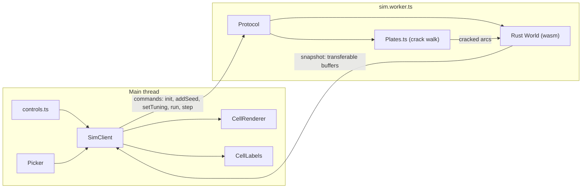

# Rust/WASM simulation in a Web Worker, plus quick wins

## Decisions already made

- **Parity:** the Rust version only has to match the TypeScript one on the Earth metrics, not tick-for-tick.
- **Threading:** single-threaded WASM for now. Per-cell passes with no ordering dependency (classification, elevation, crust lifecycle, drag accumulation, the forward-direction pass) are written as independent loops so rayon can be added later.
- **Clean-up:** the TypeScript simulation is deleted once the Rust port is verified. Crack propagation (`Plates.addSeed`) stays in TypeScript, because it only runs when you click and it's cheap.
- **Prerequisites:** commit the current uncommitted work first. Rust isn't installed on this machine yet: install `rustup`, the `wasm32-unknown-unknown` target and `wasm-pack`.

## Target architecture

The worker owns all world state: mesh, cell data, plates, registry, sutures and ledgers. The main thread keeps a read-only copy of the latest snapshot, which the renderer, labels and picker read from.

## Phase 0: baseline and benchmark scenario

- Add a dev-only benchmark URL, `?bench=level:8,seeds:12,ticks:200`. It drops seeds at fixed positions from `makeRng`, runs the given number of ticks, and logs timings per pass plus the full metric trajectory as JSON.
- Add a readout for simulation milliseconds per tick and UI-refresh milliseconds per tick next to the FPS counter in [src/ui/controls.ts](src/ui/controls.ts).
- The benchmark doubles as the parity check: the same scenario must produce metric trajectories within tolerance bands before and after each phase.

## Phase 1: quick wins (TypeScript and rendering)

Simulation side. These also set the flat data layout the Rust port will copy.

- **Mesh arrays instead of allocating accessors.** `neighbors()`, `neighbourArcs()` and `position()` in [src/mesh/IcosphereMesh.ts](src/mesh/IcosphereMesh.ts) create a new array on every call, and they're called inside nearly every hot loop. Expose the underlying CSR arrays (`neighbourOffsets`, `neighbourList`, `neighbourArcList`), plus `centres` and `areas`, as readonly fields on `CellMesh`, and switch every simulation loop to indexing them directly.
- **Precompute static per-arc geometry once per mesh.** This covers the normalised midpoint (`arcMid`), the unit tangent normal from cell A to cell B (`arcNormal`), and `arcLength`. Midpoints and normals are recomputed several times per tick in `classifyBoundaries`, `updatePlateMotion`, `updateSutures`, `closingRate` and `updateVelocities`. `arcLength()` also calls `boundaryGraph()` and `acos` on every call.
- **Precompute the unit chord direction for each neighbour entry** (`chordDir`), which the forward pass and pass 2 of `advect` compute per neighbour per tick.
- **Dense arrays per plate.** Each tick, pack each plate's angular velocity into a `Float64Array` indexed by plate id and turn `stepping` into a `Uint8Array`. This replaces the per-cell `Map`/`Set` lookups (`plateData.byId.get`, `stepping.has`, `linearVelocity`) in `advect`, `classifyBoundaries` and `updatePlateMotion`. The `drag.get` and `area.set` calls done once per cell become dense arrays too.
- **Reuse scratch buffers.** `advect` creates about 15 cell-sized typed arrays per tick, 3 more per placement round, and further copies (`before`, `labels`). At level 8 that is tens of MB of garbage per tick. Move them into a `SimScratch` object allocated once per world, and do the same in `plateLifecycle` and `rifting`.
- **Swap buffers instead of copying.** Swap the `cellData` and `backBuffer` references instead of calling `copyCellData`.
- **Remove duplicate work.** Drop the `totalCrustMass` call at the end of `advect`, since `applyCrustLifecycle` recomputes it anyway. In `rifting`, build per-plate cell lists with one counting sort instead of `Map<number, number[]>` plus `push`. Replace the `Set`s in `splitPlate` and `updatePlateIdentity` with typed marker arrays.

Render and UI side. This work is kept after the port.

- **Per-cell colour texture.** `updateColours` and `updatePlateOverlay` in [src/render/CellRenderer.ts](src/render/CellRenderer.ts) write one colour per fan vertex, about 7 vertices per cell. At level 8 that uploads roughly 55 MB per buffer per tick. Instead, store one RGBA8 colour per cell in a `DataTexture` (about 2.6 MB) and add a per-vertex `cellIndex` attribute that the shader uses to look up the colour. Also make `colourForCell` write into an output buffer instead of returning a new tuple for every cell.
- **Skip hidden work.** Skip `updateVelocities` when the arrows are hidden and rebuild them when you toggle arrows on. Throttle `refreshMetrics` and `refreshPlateList` to at most 2 Hz.

## Phase 2: Web Worker with a language-independent protocol

- Add a typed message union in `src/worker/protocol.ts`:
    - Commands from the main thread: `init(level)`, `addSeed(junction)`, `clearFaults`, `setBranches`, `setTuning(patch)`, `setSimOptions(patch)`, `run(ticksPerSecond)`, `pause`, `step`.
    - Replies from the worker: `meshReady(geometry)` and `snapshot`. A snapshot carries the tick number, `elapsedMyr`, the cell fields, `cellKind`, `arcKind`, each plate's `[id, omega]`, metrics, plate summaries and the mass readout.
- **Snapshot buffers are ping-ponged.** The worker transfers snapshot buffers to the main thread, and the main thread transfers them back after uploading. This means no copying, and no cross-origin-isolation headers are needed. When the main thread falls behind, the worker keeps ticking and sends only the latest state.
- **Build the mesh once, in the worker.** Its geometry (centres, polygon CSR, areas, neighbour CSR, boundary graph) is transferred to the main thread and wrapped in a new `ArrayCellMesh implements CellMesh`. `IcosphereMesh` becomes a builder that returns `MeshArrays`.
- **The worker initially runs the existing TypeScript simulation.** That includes `Plates`, `PlateRegistry`, `PlateData`, `step`, `updatePlateMotion`, `classifyBoundaries`, `computeMetrics` and `summaries`.
- **Rewire the main thread.** [src/main.ts](src/main.ts) loses `simTick`, `scheduleTick` and `copyCellData`. `rebuild`, `placeSeed` and `clearFaults` become messages to the worker. A new `SimClient` in `src/worker/SimClient.ts` applies each snapshot to the renderer and UI.
- **Tuning.** It stays mirrored on the main thread, because the colour ramps read it, and every change is forwarded to the worker.
- This covers [todo/11-simWebWorker.md](todo/11-simWebWorker.md). The UI no longer stutters while the simulation runs.

## Phase 3: Rust crate compiled to WASM

- **Crate:** `sim-rs/` (`tectonics-sim`, built as both `cdylib` and `rlib`).
    - Dependencies: `wasm-bindgen`, `serde` and `serde-wasm-bindgen` (to pass tuning and options across), and `indexmap`, which keeps sutures and quiet contacts in a deterministic order.
    - Release profile: `opt-level=3`, `lto`, `codegen-units=1`, `panic=abort`. Run `wasm-opt -O3` and enable the `simd128` target feature.
- **Modules mirror the TypeScript:** `mesh.rs` (icosphere, dual cells, arc geometry, chord directions), `cell_data.rs`, `plates.rs` (plate properties in a `Vec` indexed by id), `registry.rs` (flood-fill `assignPlates` plus `relabel`), `boundaries.rs`, `plate_forces.rs`, `advect.rs`, `crust_lifecycle.rs`, `elevation.rs`, `sutures.rs`, `plate_lifecycle.rs`, `rifting.rs`, `metrics.rs` (metrics and summaries) and `tuning.rs`.
- **API:** a `#[wasm_bindgen] struct World` with:
    - `new(level)`
    - `mesh_*` getters
    - `reassign_plates(cracked: &[u8])`
    - `set_tuning(JsValue)` and `set_options(JsValue)`
    - `tick()`
    - `metrics() -> JsValue`
    - raw pointers or views into the snapshot fields
- **Memory:** everything is allocated up front in `World::new`, so wasm memory never grows mid-run and the views stay valid. The worker copies from those views into the ping-pong buffers.
- **Porting order**, each step validated before the next: mesh, classification, plate forces, advection, crust lifecycle and elevation, sutures, plate identity, rifting, metrics.
    - During the transition, a `?sim=ts|wasm` switch in the worker selects which implementation runs, and the benchmark compares their metric trajectories.
- **Native Rust tests** via `cargo test`:
    - Mesh invariants: exactly 12 pentagons, total area 4π, symmetric neighbour lists.
    - The mass ledger closes.
    - Advection transport is a permutation: no cell is duplicated or dropped.
    - A native benchmark binary for profiling level 8 outside the browser.
- **Build wiring:** add an `npm run build:wasm` script (`wasm-pack build sim-rs --target web --release --out-dir ../src/sim-wasm/pkg`) and chain it before `dev` and `build` in [package.json](package.json). Add `src/sim-wasm/pkg` to `.gitignore`.

## Phase 4: remove the TypeScript simulation

- **Delete** `src/sim/advect.ts`, `crustLifecycle.ts`, `elevation.ts`, `plateForces.ts`, `plateLifecycle.ts`, `rifting.ts`, `sutures.ts`, `massBudget.ts` and `step.ts`, the simulation parts of `boundaries.ts`, `metrics.ts` and `PlateData.ts`, `PlateRegistry.ts`, and `IcosphereMesh.ts`, which is replaced by the Rust mesh plus `ArrayCellMesh`.
- **Keep** `tuning.ts`, since the UI edits it and it's forwarded to the worker. Also keep the `BoundaryKind` constants, the metric and summary types, the `EARTH` constants, `Plates.ts` (crack walk) and `makeRng`.
- **Update docs:** the tech-decisions table in [DesignDoc.MD](DesignDoc.MD), and move ticket 11 to `completedTasks/`.

## Expected outcome

- **Phase 1:** the simulation should be several times faster in TypeScript, mainly from removing allocations and `Map` lookups. Colour uploads should shrink about 20-fold.
- **Phase 2:** the main thread stays responsive at any cell count.
- **Phase 3:** a further speed-up on the simulation itself, plus a much faster world rebuild at level 8, since the current mesh build uses string keys for about 2M midpoints.
- The benchmark from Phase 0 gives actual numbers at each step instead of guesses.
