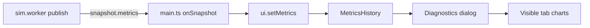

# UI overhaul

All UI is plain DOM with inline styles in [src/ui/controls.ts](src/ui/controls.ts), which is already about 1600 lines long. The plan keeps that style (no framework and no chart library, just hand-drawn SVG like the current age chart) and splits the new pieces into separate files.

## 1. Settings model changes ([src/ui/settingsStore.ts](src/ui/settingsStore.ts), [src/main.ts](src/main.ts))

- Replace `showPlates: boolean` with `plateOverlay: PlateOverlay`, where `type PlateOverlay = "off" | "lines" | "colours"`. The default is `"colours"`, which matches the current `INITIAL_SHOW_PLATES = true`.
- Add `uiHidden: boolean` (default `false`).
- Update `applyShowPlates` and `refreshPlateOverlay` in `main.ts` so that:
    - the coloured fill shows only in `"colours"`;
    - the boundary lines show in both `"lines"` and `"colours"`.

## 2. Plate boundary lines ([src/render/CellRenderer.ts](src/render/CellRenderer.ts))

- Add a `plateLines` `LineSegments` built the same way as `faultLines`: preallocate one segment per arc and use a `LineBasicMaterial` in a light colour (white, slightly transparent).
- Add `updatePlateLines(plateId)`. It loops over arcs, keeps those where `plateId[arcCells[2a]] !== plateId[arcCells[2a+1]]`, and projects the endpoints with `projectPoint(..., this.projection, FAULT_LIFT, refLon)`, using the same code as `updateFaults`. It caches `plateId` so that `setProjection` can rebuild the lines, as it already does for faults.
- Add `setPlateLinesVisible(visible)`, with `renderOrder` set above the plates fill.

## 3. Simulation panel controls ([src/ui/controls.ts](src/ui/controls.ts))

- **Subdivision level:** replace the slider with a row of small square number buttons for levels 2 to 8. Add a reusable `makeSegmented(options, selected, onPick)` helper that returns `{ row, setSelected }` and highlights the active button with the accent colour `#4f8ff0`.
- **Run / Pause:** replace `runToggle` with two side-by-side buttons. Each sets `running: true` or `running: false`, and the active state is highlighted and disabled. "Step once" and "Clear faults" stay as they are.
- **Tooltips:** add a `tooltip: string` field to `TuningSliderSpec`, with a short one-line explanation for every entry in `TUNING_GROUPS` (paraphrased from the doc comments in [src/sim/tuning.ts](src/sim/tuning.ts)). Add a `makeTooltip()` singleton: one fixed-position styled `div` shown on `mouseenter` and hidden on `mouseleave`, positioned next to the hovered label and slider. Native `title` attributes are not used because they are slow and unstyled. Also give tooltips to the "Supercontinent insulation" toggle and the "Reset tuning" button.
- Remove the inline diagnostics `
` and replace it with an "Open diagnostics" button.

## 4. View panel controls

- **Projection:** replace `makeSelect` with a segmented button pair, "Globe" (`sphere`) and "Mercator".
- **Plates overlay:** replace the checkbox with a segmented control labelled "Plates", with the options Off, Lines and Colours.
- Update the `store.subscribe` block to call `setSelected` on each segmented control instead of writing `slider.value` or `input.checked`.

## 5. Hide UI

- Add a small fixed icon button in the bottom-right corner, kept outside both panels so it stays visible when they are hidden. It toggles `uiHidden`.
- When the UI is hidden, set `display: none` on both panels, the diagnostics dialog and the note. Add the `H` key as a keyboard shortcut. The shortcut is ignored while focus is in an input.

## 6. Diagnostics dialog (new [src/ui/diagnostics.ts](src/ui/diagnostics.ts))

- Move `makeDiagnostics`, `earthAgeHistogram` and the chart constants out of `controls.ts`.
- **History:** add a `MetricsHistory` that appends one `WorldMetrics` per call to `setMetrics`, keyed by `elapsedMyr`. It skips duplicate times, clears itself when `elapsedMyr` goes backwards (which means the world was rebuilt), and is capped at about 2000 points by thinning every other point.
- **Dialog:** a draggable, closable, fixed overlay panel (a `<dialog>` element in non-modal mode, so the globe stays interactive) with a tab bar. Its open state persists while the simulation runs. Only the visible tab re-renders on each update.
- **Line chart:** add a `makeLineChart({ title, series: [{ label, get }], earth?, unit, format })` helper. It draws an SVG polyline per series against `elapsedMyr`, a dashed Earth reference line where one exists, min/max axis labels, and a hover readout. Charts with several series use distinct, legend-keyed tints.
- **Tabs and their charts:**
    - **Overview:** the existing readings grid (world value against Earth value).
    - **Plates:** `plateCount` and `majorPlateCount`, against Earth's 15 and 7.
    - **Continents:** `continentalArea` (Earth 40%), `thinContinentalArea`, `continentCount`, `largestContinentShare`, `cratonShare` and `meanContinentalThickness`.
    - **Continental budget:** a multi-series chart of `continentalisedByAccretion`, `continentalisedBySpreading`, `continentalisedByInfill`, `continentalRecycled` and `continentalGrowth`, and a second multi-series chart of `continentalEroded`, `delaminated`, `foundered` and `decontinentalised`.
    - **Ocean floor:** `meanOceanAge` and `maxOceanAge` (Earth 60 and 180), `oceanRecyclingMyr` (Earth 180, with null values leaving gaps), and the current age-area histogram (the existing bar chart).
    - **Boundaries:** stacked or multi-line chart of the four `boundaryShare` series.
    - **Plate drive:** `speedTrenchCorrelation` over time (Earth +0.8), plus a scatter of the current `drives` (speed against trench fraction).
    - **Defects:** `interiorHoles`, `interiorHolesUnfilled`, `oceanPocketCount` and `oceanPocketArea`.

## 7. Cleanup

- Delete `makeSelect` if nothing still uses it. The view-mode dropdown stays a select.
- Run `npm run typecheck` and `npm run lint`. There are currently no `@ts-ignore` comments in the touched files.
