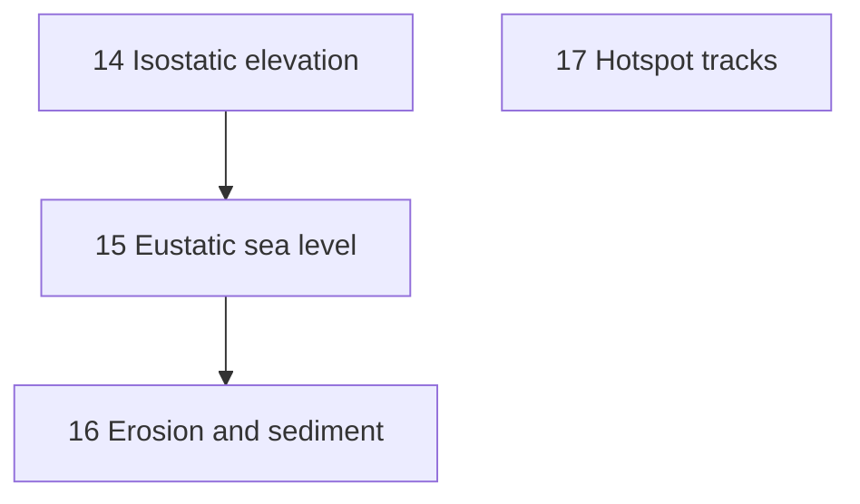

# Surface realism — iteration overview

Tickets to take the surface from "relief painted on by boundaries" to "relief
that follows from the crust, under a sea that has a fixed amount of water,
worn down by erosion". Hotspot tracks come along too, because they are cheap
and use the same plumbing.

## Where we are

The plate dynamics hold up: speeds (~6 cm/yr), mean sea-floor age (~74 Myr),
mean ocean depth (-3.7 km) and heat flow (~55 TW) all land near Earth's. The
surface does not:

- **Almost no dry land.** Level 6, 1000 ticks (3 Ga -> ~1 Ga): continental
  crust covers 13.9% of the globe, but only 2.6% stands above sea level
  (Earth: ~29%). Median continental thickness is 28.7 km, and
  `elevation.rs` puts 30 km of continent under the sea.
- **Sea level is a fixed 0 km.** On Earth it is set by a fixed volume of
  water, so it rises when ridges are young and fast and falls when the floor
  is old.
- **Elevation is decorative.** Boundaries add relief directly
  (`elevation.rs:105-125`), and it relaxes back over ~50 Myr. Nothing in the
  sim reads elevation back. Elevation (`baseline_elevation`) and buoyancy
  (`buoyancy`) are worked out by two different isostasy models.
- **Nothing erodes.** Thick crust thins only by rifting, margin erosion or
  delamination. Old orogens never wear down, and nothing builds shelves.
- **Plumes ride with the plate**, so there are no age-progressive hotspot
  chains.

## Tickets

| #  | Ticket                         | Size | Changes dynamics? |
| -- | ------------------------------ | ---- | ----------------- |
| 14 | Isostatic elevation            | M    | No (output only)  |
| 15 | Eustatic sea level             | S    | No (output only)  |
| 16 | Erosion and sediment           | M-L  | Yes (moves crust) |
| 17 | Hotspot tracks                 | S    | Slightly          |

Sizes are rough: S is a few days, M about a week, L more. Most of the effort
in 14-16 is calibration, not code.

## Sequencing

- 14 before 15: the sea-level solve needs elevation to be a function of the
  column, and the water load ties them together (see 15).
- 15 before 16: erosion needs a base level to erode down to and to deposit
  against.
- 17 is independent. It is the smallest, so it makes a good warm-up, or it can
  run alongside 14.

## Decisions (locked)

1. **Player edits are out of scope.** They belong to a later game stage that
   runs after the simulation, so derived elevation needs no override path
   now. Whatever that stage does, it can work on the finished world's crust.
2. **Values come from the system, not from an era.** Nothing is tuned to hit
   a land share, a sea level or a hypsometry at some chosen point in time.
   Calibration fixes only the physical inputs: material densities, the water
   load, the volume of water, how keels and lids weigh. Its tests are about
   individual columns: given this crust and lid, the column stands here.
   Land area, sea level and the rest are outcomes to report and watch, not
   targets. Earth figures appear only as sanity ranges for those inputs.
3. **The sea-level slider goes.** Its replacement is an ocean volume control
   in the same place. Changing it re-solves sea level and re-colours the map
   at once, even while paused (see 15), so it handles like the slider did,
   but the result is physically consistent.
4. **Sediment tracer: yes.** Add a `sediment_share` field (see 16) so hot-era
   drip does not founder sediment as if it were mafic crust.

## Cross-cutting rules

- Every new tuning field goes in `sim-rs/src/tuning.rs` and
  `src/sim/tuning.ts`, documented in the TypeScript as the others are, and in
  the tuning UI where it is worth dialling.
- Mass that moves between cells is a permutation or a transfer, never a
  creation. `mass_ledger_closes` and the drift readout stay at zero.
- The four-thread vs one-thread fingerprint test must still pass: reductions go
  through `par::sum`, and any sort breaks ties by cell index.
- Before each ticket, record a bench baseline:
  `npm run bench -- level:6,seeds:12,ticks:1000 before.json`. Afterwards,
  compare with `npm run bench:compare`. Tickets 14, 15 and 17 should leave
  every dynamics metric inside its band. Ticket 16 will move some, and the
  bands are updated deliberately in that ticket, with the reasons recorded.
- Rebuild both WASM packages (`build:wasm`, `build:wasm:threads`).

## Out of scope this iteration (future work)

- **Supercontinent cycle check.** The level 6 run recorded 0 continental
  breakups (two continent-bearing plates splitting) in 2 Gyr, along with 0
  weld merges and 0 passive-margin collapses. Run a multi-seed ensemble
  (`sim-rs/target/ensemble.py`) before deciding whether anything is wrong.
- **Arc placement and back-arcs.** Arcs sit on the cell beside the trench;
  real arcs are 100-200 km behind it. Back-arc spreading on rollback is
  missing too.
- **Microplate jitter.** There were 157 heading reversals (>120 deg in
  10 Myr), 145 of them on plates under 1% of the globe, plus ~2,700
  absorbed fragments: artefacts of moving crust a whole cell at a time.
- **Ridge-transform segmentation.**
- **Continental area well short of target** (13.9% against 0.4). This is
  partly a mesh-resolution ceiling. Revisit after 16, since sediment shelves
  will change it.
- **`continental_area_target` is an imposed outcome.** The recycling
  controller (`recycling.rs`) adjusts recycling to hold continents at a
  chosen share of the globe, which runs against decision 2. With explicit
  sediment subduction from 16 in place, consider dropping the target and
  letting the area come from the balance of arcs, plumes, sediment and
  subduction.
- **Plume drift with mantle flow** (the Hawaii-Emperor bend), after 17.
